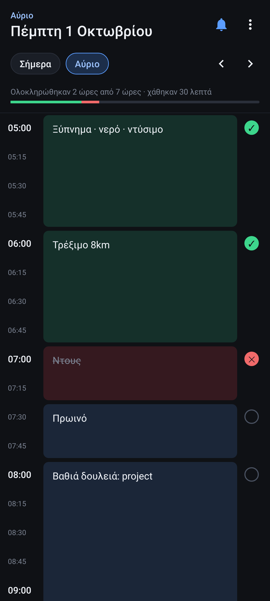

# Timetable

Ημερήσιο πρόγραμμα σε κουτάκια των 15 λεπτών (05:00 – 24:00), για να γράφεις από το
προηγούμενο βράδυ τι θα κάνεις την επόμενη μέρα και να το τσεκάρεις (✓ / ✗) μέσα στη μέρα.



## Εγκατάσταση

Κατέβασε το [`apk/Timetable.apk`](apk/Timetable.apk) στο κινητό και άνοιξέ το. Το Android θα
ζητήσει να επιτρέψεις «εγκατάσταση από άγνωστες πηγές» για την εφαρμογή από την οποία το άνοιξες
(Chrome, Files κ.λπ.).

## Χρήση

- **Σήμερα / Αύριο**: γρήγορη εναλλαγή ημέρας. Με ‹ › πας μέρα-μέρα, πατώντας την ημερομηνία διαλέγεις από ημερολόγιο.
- **Πάτα ένα κουτί** → γράφεις τι θα κάνεις και διαλέγεις διάρκεια (15', 30', 1ω… ή με − / +).
  Τα κουτιά με την ίδια δραστηριότητα ενώνονται σε ένα block.
- **Πάτα ένα γεμάτο block** → αλλάζεις κείμενο/διάρκεια ή το διαγράφεις.
- **Κράτα πατημένο** ένα γεμάτο κουτί → νέα δραστηριότητα από εκείνη ακριβώς την ώρα.
- **Κύκλος δεξιά**: ○ → ✓ (έγινε) → ✗ (δεν έγινε). Πάνω δεξιά βλέπεις πόσες ώρες έβγαλες.
- **🔔 (πάνω δεξιά)**: ειδοποίηση στην αρχή κάθε δραστηριότητας. Ένα πάτημα την ανοίγει ή την κλείνει για όλες τις μέρες.
- **⋮**: αντιγραφή προγράμματος από χθες ή άλλη μέρα, μηδενισμός ✓/✗, καθαρισμός ημέρας.
- Μετά τις 18:00, αν δεν έχεις γράψει το αύριο, εμφανίζεται υπενθύμιση πάνω από τη λίστα.

Τα δεδομένα μένουν μόνο στο κινητό, ένα μικρό αρχείο ανά μέρα (`files/days/YYYY-MM-DD.json`),
ώστε η εφαρμογή να μένει εξίσου γρήγορη όσο ιστορικό κι αν μαζευτεί.

## Build

```sh
./build.sh   # -> build/Timetable.apk
```

Δεν χρειάζεται Android SDK ή Gradle: το script κατεβάζει από Maven Central τα aapt2
(apktool), android-all (Robolectric), dx και apksig. Χρειάζεται JDK 17+, python3 και curl.

Το `keystore/timetable.p12` (κωδικός `timetable`) υπογράφει το APK. Κράτα το ίδιο κλειδί ώστε
οι νέες εκδόσεις να εγκαθίστανται πάνω στην παλιά χωρίς να χαθούν τα δεδομένα. Για νέα έκδοση
ανέβασε το `VERSION_CODE` στο `build.sh`.

---

# Gallery

Gallery για Android 11+ (APK). Δείχνει όλες τις φωτογραφίες και τα βίντεο του κινητού.

Εγκατάσταση: κατέβασε το [`apk/Gallery.apk`](apk/Gallery.apk) και άνοιξέ το, όπως το Timetable.

- **Φωτογραφίες**: όλα μαζί, τα πιο πρόσφατα πρώτα, χωρισμένα ανά μέρα. **Τσίμπημα** με δύο δάχτυλα αλλάζει τις στήλες (2–6).
- **Άλμπουμ**: ένα ανά φάκελο (Κάμερα, Στιγμιότυπα οθόνης, WhatsApp…), καθώς και Αγαπημένα και Κάδος.
- **Πάτα** μια φωτογραφία για να την ανοίξεις. Σύρε αριστερά/δεξιά για την επόμενη ή την προηγούμενη, κάνε ζουμ με δύο δάχτυλα ή διπλό πάτημα, και πάτα μία φορά για να κρύψεις τις μπάρες. Τα βίντεο παίζουν με ένα πάτημα.
- Κάτω μπάρα: κοινοποίηση, ♥ αγαπημένο, πληροφορίες (ημερομηνία, διαστάσεις, μέγεθος, φάκελος), διαγραφή.
- **Κράτα πατημένο** για να επιλέξεις πολλά και να τα κοινοποιήσεις, να τα κάνεις αγαπημένα ή να τα διαγράψεις μαζί.
- Η διαγραφή πάει στον **κάδο** του Android για 30 ημέρες. Από τον Κάδο κάνεις επαναφορά ή οριστική διαγραφή. Το Android ζητά επιβεβαίωση σε κάθε αλλαγή.
- Εμφανίζεται στο «Άνοιγμα με…» όταν πατάς φωτογραφία ή βίντεο σε άλλη εφαρμογή.

Build: `./gallery/build.sh` → `build/Gallery.apk` (ίδια εργαλεία και κλειδί με το Timetable). Τρέχει
πρώτα το `gallery/test/SectionsTest.java`. Για νέα έκδοση ανέβασε το `VERSION_CODE` στο `gallery/build.sh`.

---

Στο ίδιο repository: [**Ανάλυση Αγώνων**](football/README.md), μια εφαρμογή web για κινητό με
πιθανότητες για ποδοσφαιρικούς αγώνες.
