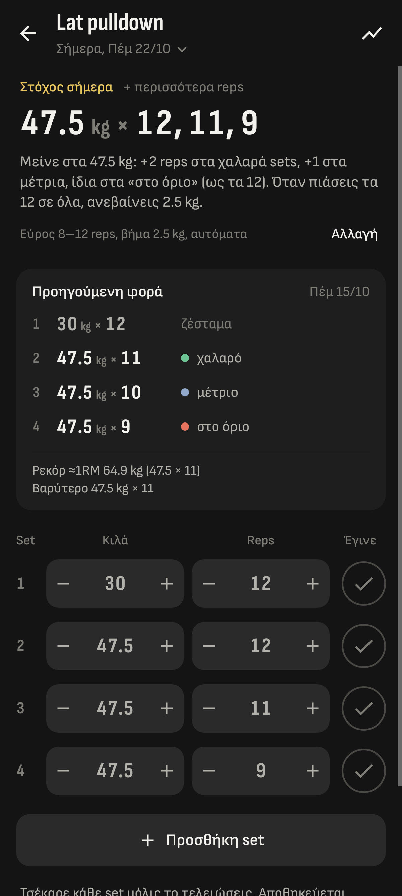
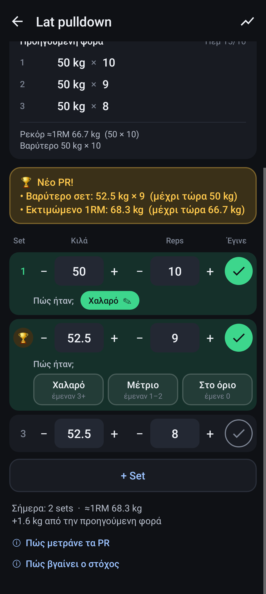

# Gym Notes

Απλό σημειωματάριο γυμναστηρίου: έως 7 προγράμματα (π.χ. ένα για κάθε μέρα), οι ασκήσεις του
καθενός και τα sets / κιλά / reps που έκανες, με αναγνώριση πραγματικών PR.

   

## Εγκατάσταση

Κατέβασε το [`apk/GymNotes.apk`](../apk/GymNotes.apk) στο κινητό και άνοιξέ το. Το Android θα
ζητήσει να επιτρέψεις «εγκατάσταση από άγνωστες πηγές» για την εφαρμογή από την οποία το άνοιξες
(Chrome, Files κ.λπ.). Δουλεύει σε Android 8 και νεότερα (το Motorola G86 έχει Android 15).

## Χρήση

- **Προγράμματα**: «Νέο πρόγραμμα» (έως 7). Πάτα ένα πρόγραμμα για να το ανοίξεις. Κράτα το
  πατημένο για μετονομασία, αλλαγή σειράς ή διαγραφή.
- **Μέσα σε πρόγραμμα**: «Προσθήκη άσκησης». Ψάχνεις στη λίστα σου ή γράφεις όνομα για νέα άσκηση.
  Κάθε άσκηση δείχνει τον στόχο της, τι έκανες την τελευταία φορά και αν έγινε σήμερα. Με το ⋮
  αλλάζεις σειρά ή βγάζεις την άσκηση από το πρόγραμμα.
- **Καταγραφή**: πάτα μια άσκηση. Τα sets ξεκινάνε συμπληρωμένα με ό,τι έκανες την προηγούμενη φορά.
  Άλλαξε κιλά / reps (με − / + ή γράφοντας) και τσέκαρε τον κύκλο δεξιά μόλις τελειώσεις κάθε set.
  Αποθηκεύεται αμέσως. Αν αλλάξεις τα κιλά ενός set, αλλάζουν και τα επόμενα που δεν έχεις τσεκάρει.
  «Προσθήκη set» για παραπάνω sets. Κράτα πατημένο ένα set για διαγραφή. Πατώντας την ημερομηνία κάτω
  από το όνομα της άσκησης γράφεις για παλιότερη μέρα (τότε φαίνεται με κίτρινο).
- **Κοινές ασκήσεις**: μια άσκηση είναι μία, όσα προγράμματα κι αν την έχουν. Αν ανέβασες κιλά στο
  «Lat pulldown» την Παρασκευή, το βλέπεις και στο πρόγραμμα της Δευτέρας.
- **Ασκήσεις** (καρτέλα στην αρχική): όλες οι ασκήσεις σου, με αναζήτηση, «+» για νέα, και με
  παρατεταμένο πάτημα μετονομασία ή διαγραφή. Πάτα μία για ιστορικό, ρεκόρ και γράφημα προόδου.
- **Export your workout data**: αποθηκεύει όλα τα δεδομένα σε ένα αρχείο `.json` όπου θες (Λήψεις,
  Drive κ.λπ.).
- **Insert your workout data**: φέρνει πίσω ένα τέτοιο αρχείο. Διαλέγεις «Συγχώνευση» (κρατάει τα
  τωρινά και προσθέτει όσα λείπουν) ή «Αντικατάσταση» (μένουν μόνο του αρχείου).

## Πότε λέει PR

Δεν μετράει κιλά × reps, γιατί τότε το 1 kg × 100 θα «νικούσε» τα 100 kg × 5. Ένα set είναι PR μόνο
αν, σε σχέση με όλες τις προηγούμενες φορές της άσκησης (από όποιο πρόγραμμα κι αν τις έγραψες):

- **PR βάρους**: σήκωσες περισσότερα κιλά από ποτέ.
- **PR 1RM**: το εκτιμώμενο μέγιστο για 1 επανάληψη (Epley: κιλά × (1 + reps/30)) ξεπέρασε το ρεκόρ
  σου. Μετράνε έως 12 reps: ένα set των 20 λογίζεται σαν 12, ώστε τα ελαφριά set με πολλές
  επαναλήψεις να μη βγάζουν ψεύτικη δύναμη.
- **PR reps**: περισσότερες επαναλήψεις από κάθε άλλη φορά με αυτά τα κιλά ή και βαρύτερα. Μετράει
  μόνο σε κιλά που έχεις ξαναδουλέψει και είναι τουλάχιστον 75% του βαρύτερού σου (ή σωματικό βάρος,
  0 kg). Έτσι τα sets ζεστάματος δεν μετράνε.

Η πρώτη φορά μιας άσκησης είναι η βάση σου, γι' αυτό δεν βγάζει PR. Κάτω από τα sets βλέπεις και
τη σύγκριση με την προηγούμενη φορά (εκτιμώμενο 1RM, όχι όγκο).

## Πόσο να ανεβάσεις την επόμενη φορά

Σε κάθε άσκηση η εφαρμογή σού λέει τι να κάνεις, από τις δικές σου καταγραφές (από όποιο πρόγραμμα
κι αν τις έγραψες):

- **Στόχος σήμερα**: πάνω στην οθόνη της άσκησης, με την εξήγηση από κάτω. Τα sets ξεκινάνε ήδη
  συμπληρωμένα με τον στόχο (και τα sets ζεστάματος της προηγούμενης φοράς).
- **Προηγούμενη φορά**: πίνακας με ένα set ανά γραμμή, στην ίδια σειρά με τις γραμμές από κάτω,
  με το πώς ήταν το καθένα (χρώμα).
- **Πώς ήταν;** σε κάθε set: μόλις το τσεκάρεις, σε ρωτάει **Χαλαρό** (έμεναν 3+ reps), **Μέτριο**
  (έμεναν 1–2) ή **Στο όριο** (δεν έμενε άλλο). Ένα πάτημα, και η απάντηση μένει ως ετικέτα που
  πατιέται για αλλαγή. Είναι προαιρετικό, αλλά κάνει τους στόχους πολύ πιο σωστούς (δες παρακάτω).
- **Επόμενη φορά**: μόλις τσεκάρεις όλα τα sets, εμφανίζεται τι να κάνεις την επόμενη φορά. Το
  βλέπεις και μέσα στα προγράμματα και στο ιστορικό.

  

Πώς αποφασίζει:

- **Set προς set**: την επόμενη φορά +2 reps σε ένα set που ήταν χαλαρό, +1 σε μέτριο (ή αν δεν το
  βαθμολόγησες), ίδια σε «στο όριο». Όταν όλα τα sets φτάσουν (ή θα έφταναν, με όσα σου περίσσευαν)
  το πάνω όριο του εύρους σου, ανεβαίνεις ένα βήμα κιλών, και τα reps στο νέο βάρος βγαίνουν από όσα
  *μπορούσες* να κάνεις, όχι μόνο από όσα έκανες.
- **Καλή / κακή μέρα**: κάθε προπόνηση συγκρίνεται με τις συνηθισμένες σου, με βάση όσα μπορούσες
  να κάνεις. Μετά από κακή μέρα δεν κατεβάζει κιλά, σου δίνει ξανά ακριβώς τον ίδιο στόχο. Μετά από
  πολύ καλή μέρα ανεβαίνεις το πολύ ένα βήμα. Τα όρια ξεκινάνε στο −5% / +6% και προσαρμόζονται στο
  πόσο κυμαίνονται τα δικά σου νούμερα, από τις τελευταίες έως 16 προπονήσεις («Διακύμανση μέρας»
  στο ιστορικό της άσκησης).
- **Κόλλημα**: 4 φορές στα ίδια κιλά χωρίς καμία βελτίωση → ~10% πιο ελαφριά και ξαναχτίζεις. Όχι
  ξανά όσο φαίνεται ακόμα η προηγούμενη μείωση, και ποτέ λόγω μιας μόνο κακής μέρας.
- **Διάλειμμα**: 14+ μέρες → ξανά τα ίδια, 28+ μέρες → ~10% πιο ελαφριά.
- **Εκτός εύρους**: αν ανέβηκες μόνος σου πολλά κιλά και τα reps έπεσαν κάτω από το εύρος, σου λέει
  το βάρος που σε ξαναφέρνει μέσα.
- **Ασφάλεια**: ποτέ πάνω από +10% σε μία φορά. Σε ελαφριούς αλτήρες, όπου ένα βήμα είναι μεγάλο
  άλμα, κάνεις πρώτα λίγα reps παραπάνω.
- **Εύρος reps και βήμα κιλών**: βγαίνουν αυτόματα. Το εύρος από τις πρώτες σου καταγραφές, ώστε να
  μη «σέρνεται» με τον καιρό, και το βήμα από όλα τα κιλά που έχεις χρησιμοποιήσει (2.5 kg στο
  μηχάνημα, 2 kg στους αλτήρες κ.λπ.). Τα αλλάζεις πατώντας «Αλλαγή» κάτω από τον στόχο ή από
  το ⋮ του ιστορικού.

### Επαλήθευση

Εκτός από τα tests για κάθε κανόνα, τρέχει προσομοίωση με 300 «αθλητές» × 6 τύπους (σταματάει στον
στόχο ή πάει ως το πάνω όριο, βαθμολογεί κανένα / τα μισά / όλα τα sets, με λάθος βαθμολογία στο 25%
των φορών), προσωπική διακύμανση ±1.5% / ±3% / ±5%, κακές και πολύ καλές μέρες, φάσεις προόδου,
κόλλημα και διάλειμμα 40 ημερών: 196.200 προπονήσεις. Σε όλες:

- καμία πρόταση πάνω από +10% και καμία μείωση κιλών μετά από μία κακή μέρα,
- ο στόχος ακολουθεί το 91–96% της πραγματικής δύναμης,
- ζητάει περισσότερα από όσα μπορείς σε κανονική μέρα σπάνια (0–3% των φορών).

Τι κερδίζεις με τη βαθμολογία ανά set (για κάποιον που σταματά στον στόχο, προπονήσεις 12–29):
σωστός στόχος (0–3 reps περιθώριο σε κανονική μέρα) **40%** χωρίς βαθμολογία, **64%** με τα μισά
sets βαθμολογημένα, **85%** με όλα. Η προσαρμογή των ορίων «κακής/καλής μέρας» στη δική σου
διακύμανση είναι μικρότερη βελτίωση: +2 έως +8 μονάδες στη σωστή αναγνώριση στις πρώτες
προπονήσεις, περίπου ίδια (±1.5) αργότερα, ποτέ ουσιαστικά χειρότερη από τα σταθερά όρια.

## Ταχύτητα με τα χρόνια

Όλα τα δεδομένα είναι σε μία βάση SQLite. Τα sets κάθε άσκησης αποθηκεύονται συνεχόμενα (πίνακας
ταξινομημένος ανά άσκηση και ημέρα), οπότε το άνοιγμα μιας άσκησης διαβάζει μόνο το δικό της κομμάτι.
Τα ρεκόρ, η τελευταία φορά και οι αυτόματες ρυθμίσεις προόδου κάθε άσκησης κρατιούνται έτοιμα και ενημερώνονται σε κάθε αλλαγή, οπότε
οι λίστες δεν ψάχνουν ποτέ όλο το ιστορικό. Σε δοκιμή με 2 χρόνια δεδομένων (12 ασκήσεις, 3 φορές τη
βδομάδα, ~15.000 sets) κάθε οθόνη φορτώνει σε περίπου 1 ms και οι στόχοι ενός προγράμματος 12 ασκήσεων σε ~3 ms (ο στόχος
κοιτάει μόνο τις τελευταίες 8 φορές). Το export και το import διαβάζουν και
γράφουν το αρχείο τμηματικά (~800 KB για όλα αυτά).

## Εμφάνιση

Σκούρο θέμα για το γυμναστήριο, με ένα μόνο χρώμα έμφασης: κίτρινο για τον στόχο και τα PR. Τα
χρώματα πράσινο / μπλε / κόκκινο είναι μόνο για το πώς ήταν κάθε set. Γραμματοσειρά Sofia Sans για το κείμενο και
Sofia Sans Condensed για κιλά και reps, μέσα στην εφαρμογή (ελληνικά και λατινικά, ~290 KB, άδεια SIL
Open Font License: [`FONT-LICENSE.txt`](FONT-LICENSE.txt)).

## Build

```sh
gym/build.sh   # -> gym/build/GymNotes.apk
```

Ίδιο toolchain με το Timetable: χωρίς Android SDK ή Gradle, όλα από Maven Central (JDK 17+,
python3, curl). Το `keystore/gymnotes.p12` (κωδικός `gymnotes`) υπογράφει το APK. Κράτα το ίδιο
κλειδί ώστε οι νέες εκδόσεις να εγκαθίστανται πάνω στην παλιά χωρίς να χαθούν τα δεδομένα. Για νέα
έκδοση ανέβασε το `VERSION_CODE` στο `gym/build.sh`.
