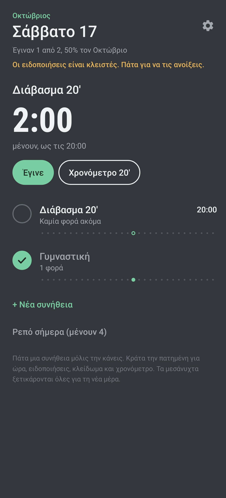
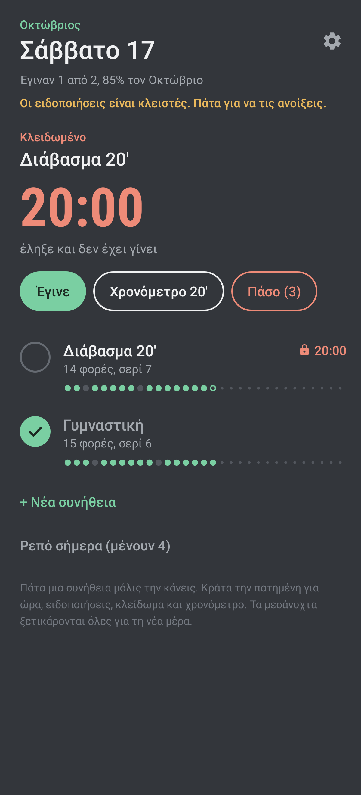
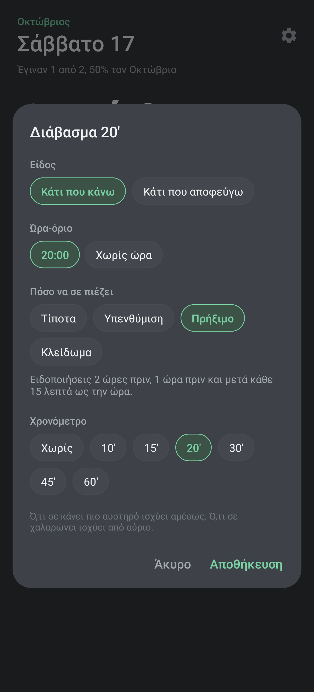
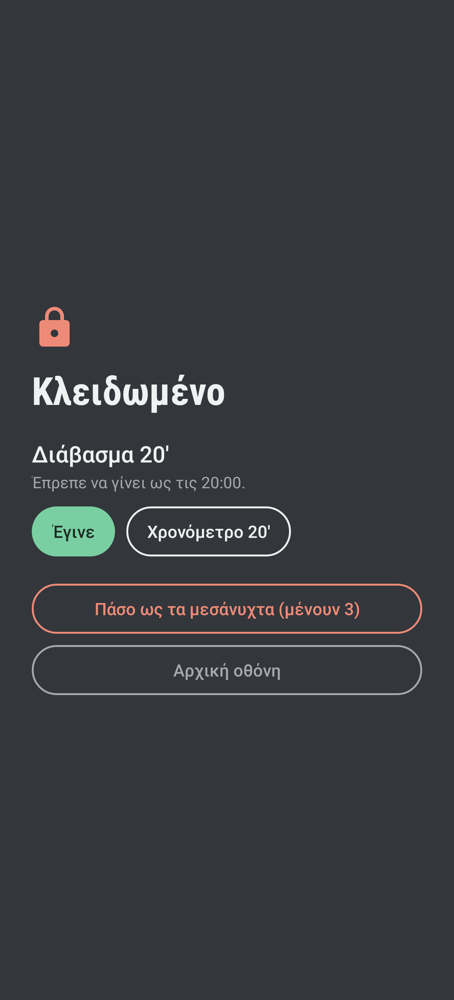
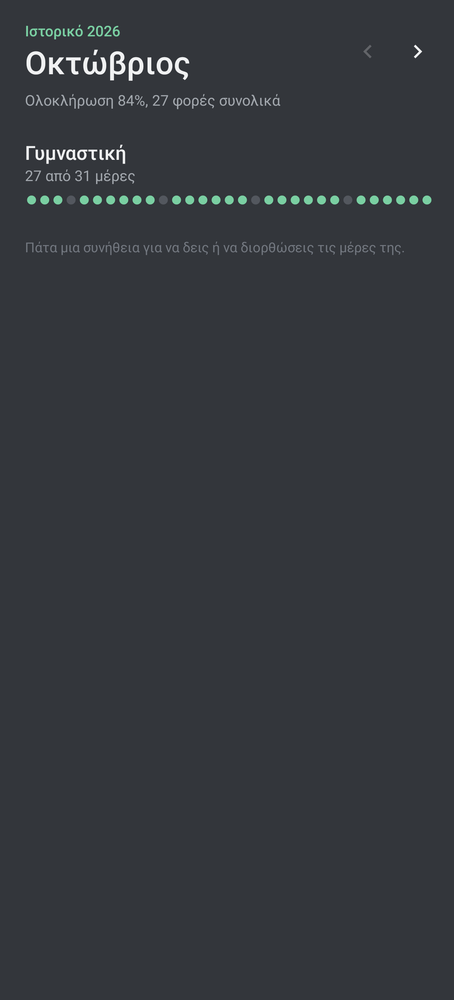
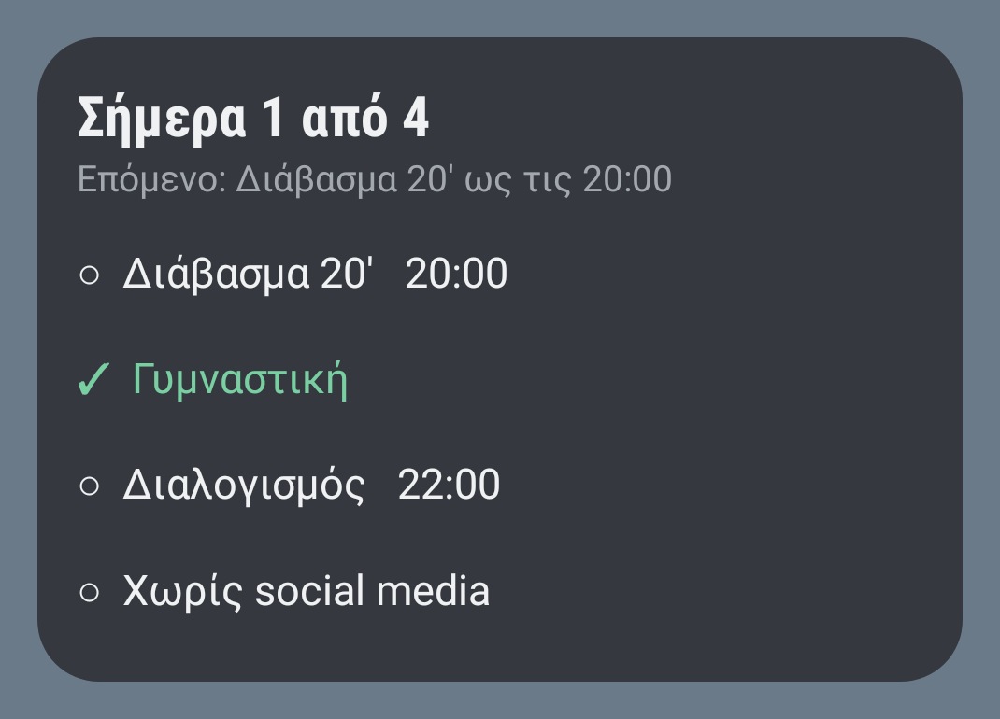

# Habits

Καθημερινές συνήθειες (3 – 6) που τικάρεις μόλις τις κάνεις. Κάθε μέρα ξεκινούν ξανά άτικες και η
εφαρμογή μετράει πόσες μέρες έκανες την καθεμία μέσα στον μήνα. Κάθε νέος μήνας ξεκινά τη μέτρηση
από το μηδέν, ενώ οι προηγούμενοι μένουν στο ιστορικό.

Όσο θέλεις, σε πιέζει κιόλας: σε κάθε συνήθεια βάζεις ώρα-όριο και ένταση, από μια απλή υπενθύμιση
ως κλείδωμα του κινητού μέχρι να την κάνεις. Χωρίς αυτά, είναι σκέτο tracker.

  

  

## Εγκατάσταση

Κατέβασε το [`apk/Habits.apk`](../apk/Habits.apk) στο κινητό και άνοιξέ το. Το Android θα ζητήσει
να επιτρέψεις «εγκατάσταση από άγνωστες πηγές» για την εφαρμογή από την οποία το άνοιξες
(Chrome, Files κ.λπ.). Μπαίνει πάνω στην προηγούμενη έκδοση και κρατάει τα δεδομένα.

## Χρήση

- **Πάτα μια συνήθεια** μόλις την κάνεις → γεμίζει ο κύκλος ✓. Ξαναπάτα για να το αναιρέσεις.
  Τα μεσάνυχτα όλοι οι κύκλοι αδειάζουν για τη νέα μέρα.
- **Πάνω** φαίνεται ό,τι βιάζεται περισσότερο: η επόμενη ώρα-όριο με αντίστροφη μέτρηση (κίτρινο
  όταν μένει λιγότερο από μία ώρα, κόκκινο όταν έληξε), το χρονόμετρο που τρέχει, ή το κλείδωμα.
- **Τελείες** κάτω από κάθε συνήθεια: μία για κάθε μέρα του μήνα. Η παύλα είναι ρεπό. Για να
  διορθώσεις προηγούμενες μέρες: κράτα πατημένη τη συνήθεια → «Ημερολόγιο μήνα».
- **Κράτα πατημένη** μια συνήθεια → ώρα, ειδοποιήσεις, κλείδωμα, μετονομασία, ημερολόγιο, σειρά, διαγραφή.
- **+ Νέα συνήθεια** → μέχρι 6. Αν μπει στη μέση του μήνα, μετράει από εκείνη τη μέρα.
- **Ιστορικό** (ρολόι πάνω δεξιά): οι προηγούμενοι μήνες, με ‹ › από μήνα σε μήνα.

### Ώρα, ένταση, κλείδωμα

Για κάθε συνήθεια:

| Ένταση | Τι κάνει |
|---|---|
| Τίποτα | Μόνο το τικ. |
| Υπενθύμιση | Μία ειδοποίηση μία ώρα πριν από την ώρα. |
| Πρήξιμο | Ειδοποιήσεις 2 ώρες πριν, 1 ώρα πριν και μετά κάθε 15 λεπτά ως την ώρα. |
| Κλείδωμα | Όπως το πρήξιμο, και στην ώρα κλειδώνει **όλες τις εφαρμογές** (εκτός από τις εξαιρέσεις) ή **μόνο τη λίστα σου**, μέχρι να την κάνεις. |

- Οι ειδοποιήσεις έχουν κουμπιά «Έγινε» και «Χρονόμετρο».
- **Χρονόμετρο** (10' – 60', ή όσα λεπτά θες με «Άλλο», ως 240'): μετράει αντίστροφα και τικάρει τη συνήθεια μόλις τελειώσει. Διαλέγεις
  ανά συνήθεια:
  - **Και «Έγινε»**: μπορείς και να την τικάρεις αμέσως.
  - **Μόνο με χρονόμετρο**: όπου κι αν πατήσεις τικ (λίστα, ειδοποίηση, widget, κλείδωμα) ξεκινά το
    χρονόμετρο, και η συνήθεια τικάρεται μόνο όταν τελειώσει. Τρέχει ένα χρονόμετρο τη φορά, και ένα
    λάθος πάτημα δεν σβήνει αυτό που τρέχει.
- **Συνήθειες αποχής** («Χωρίς social media»): προαιρετικά μπλοκάρουν τη λίστα σου σε ώρες που
  ορίζεις, και τα μεσάνυχτα τικάρονται μόνες τους αν δεν χρειάστηκε πάσο (και το κλείδωμα ήταν ανοιχτό).
- Οι κλήσεις, το 112, η αρχική οθόνη, το πληκτρολόγιο και οι Ρυθμίσεις δεν κλειδώνουν ποτέ.

**Ό,τι σε κάνει πιο αυστηρό ισχύει αμέσως. Ό,τι σε χαλαρώνει ισχύει από αύριο**: πιο χαλαρή ένταση,
πιο αργή ώρα, λιγότερες εφαρμογές στη λίστα, κλείσιμο του γενικού διακόπτη, διαγραφή συνήθειας με
ενεργούς κανόνες, αφαίρεση φίλων.

- **Πάσο** (3 τον μήνα): ξεκλειδώνει τα πάντα μέχρι τα μεσάνυχτα. Η μέρα μετράει ως «δεν έγινε»
  και οι φίλοι σου ενημερώνονται.
- **Ρεπό** (4 τον μήνα): καμία ειδοποίηση και κανένα κλείδωμα για σήμερα, και το σερί δεν σπάει.
  Δηλώνεται πριν από το πρώτο όριο της μέρας.
- **Γενικός διακόπτης** (Ρυθμίσεις): κλειστός, η εφαρμογή είναι σκέτο tracker.

### Φίλοι, widget, ανασκόπηση

- **Φίλοι**: μέχρι 3 τηλέφωνα (SMS από το κινητό σου) και 3 email (από δικό σου Gmail). Παίρνουν
  μήνυμα όταν χρησιμοποιείς πάσο, και τα μεσάνυχτα για όποια συνήθεια με κλείδωμα δεν έγινε.
- **Widget**: κράτα πατημένη την αρχική οθόνη → Widgets → Habits. Τικάρεις με ένα πάτημα.
- **Ανασκόπηση Κυριακής** στις 21:00: η εβδομάδα σου, συνήθεια προς συνήθεια.

## Ρύθμιση στο κινητό (μία φορά)

1. **Ειδοποιήσεις**: η εφαρμογή τις ζητά μόλις βάλεις την πρώτη υπενθύμιση.
2. **Κλείδωμα**: Ρυθμίσεις της εφαρμογής → «Ενεργοποίηση κλειδώματος».
   - «Πληροφορίες εφαρμογής» → ⋮ πάνω δεξιά → «Να επιτρέπονται οι περιορισμένες ρυθμίσεις».
     Το Android το ζητά επειδή η εφαρμογή δεν ήρθε από το Play Store.
   - «Προσβασιμότητα» → Habits → ενεργοποίηση. Η εφαρμογή βλέπει μόνο ποια εφαρμογή είναι μπροστά.
3. **Μπαταρία**: «Χωρίς περιορισμό μπαταρίας», ώστε η Motorola να μην καθυστερεί ειδοποιήσεις και κλειδώματα.
4. **SMS σε φίλους**: η εφαρμογή ζητά την άδεια μόλις βάλεις τηλέφωνο. Αν το Android την αρνηθεί,
   κάνε πρώτα το «περιορισμένες ρυθμίσεις» του βήματος 2.
5. **Email σε φίλους**: «Αποστολή email από» → η διεύθυνση Gmail σου και ένας **κωδικός εφαρμογής**
   (Λογαριασμός Google → Ασφάλεια → Επαλήθευση σε 2 βήματα → Κωδικοί εφαρμογών). Μένει μόνο στο
   κινητό και δεν μπαίνει στα αντίγραφα ασφαλείας.

Τα δεδομένα μένουν μόνο στο κινητό: ένα μικρό αρχείο ανά μήνα (`files/months/YYYY-MM.json`) και οι
κανόνες σε ένα αρχείο ρυθμίσεων. Κάθε μήνας διαβάζεται μία φορά και μένει στη μνήμη, οπότε η εφαρμογή
μένει εξίσου γρήγορη όσο ιστορικό κι αν μαζευτεί.

## Build

```sh
./build.sh   # -> build/Habits.apk
```

Ίδια διαδικασία με το Timetable (`../build.sh`): χωρίς Android SDK ή Gradle, με τα ίδια εργαλεία
(`../.tools`, `../tools`) και το ίδιο κλειδί (`../keystore`). Για νέα έκδοση ανέβασε το
`VERSION_CODE` στο `build.sh`.

## Τεστ

```sh
test/run.sh                    # όλα
test/run.sh -Dtest=CoreTest    # μία ομάδα
```

Τρέχουν την εφαρμογή σε προσομοίωση Android (Robolectric) με Maven, χωρίς κινητό. Το ρολόι του
«κινητού» το ορίζει κάθε τεστ με το libfaketime (`apt-get install faketime`). Τα στιγμιότυπα οθόνης
πηγαίνουν στο `test/out/`.
